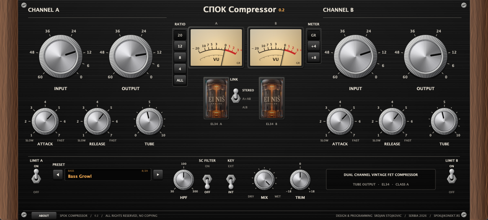
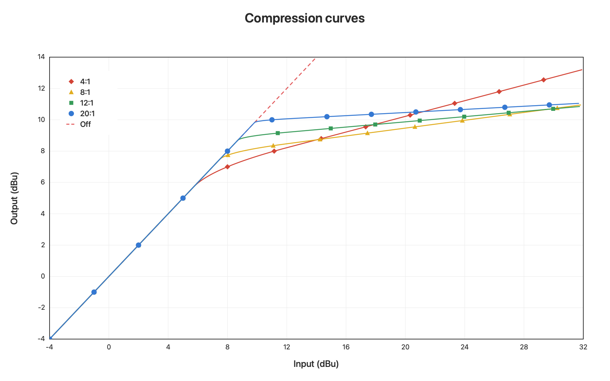

# Spok Compressor 0.2 — Dual Channel FET Compressor / Limiter -  tube output  :)

<p align="center">
  <strong>VST3 analog FET compressor / limiter. EI Niš EL34 tube output.</strong>
</p>

<p align="center">
  A dual-channel vintage FET compressor and limiter with a feedback gain cell
  and a class-A <strong>EI Niš EL34</strong> tube output. Input, attack, release
  and tube drive are per channel. Ratio, stereo link, sidechain and mix are shared.
</p>

<p align="center">
  FET Gain Cell · 4:1 / 8:1 / 12:1 / 20:1 / All · 20 µs Attack · EI Niš EL34 · Tube Output · Stereo Link · External Sidechain
</p>

<p align="center">
  <a href="https://github.com/spok-sto/SpokCompressor">
    
  </a>
  
  
  
  
</p>

<p align="center">
  <a href="docs/SpokCom.png">
    
  </a>
</p>

https://www.youtube.com/watch?v=0rJou21Gxoo
---

## What's new in 0.2

- 20 factory presets for vocal, bass, drums, guitar and bus

---

## Why Spok Compressor?

A FET compressor is fast, and it colors the sound while it controls it. Spok Compressor follows that path: a feedback FET gain cell, then a real tube stage.
The EL34 is the EI Niš power pentode used in Spok Quantum. Turning **Tube** up drives the pentode and the output transformer.

- **Fast enough for drums and vocals** — attack from 20 to 800 microseconds
- **Ratios of a classic limiter** — 4:1, 8:1, 12:1, 20:1, and All
- **Two channels** — Stereo link, A into both, or dual mono
- **EI Niš EL34** — tube drive and output-transformer weight on each channel
- **20 presets** — vocal, bass, drums, guitar and bus starting points

---

## Signal path

> **How does a sound travel through Spok Compressor?**

```text
Input
  │
  ▼
[01] INPUT  →  input transformer
[02] FET GAIN CELL  (feedback, program-dependent gain reduction)
     └── preamp  
[03] OUTPUT  →  EI NIŠ EL34  →  output transformer
     └── the detector listens here, so Tube and Output are inside the loop
[04] MIX with the dry signal, then TRIM
```

An external sidechain key replaces the detector feed. The sidechain high-pass (30–300 Hz) is on the detector only. The audio path keeps its low end.

## Compression curves

<p align="center">
  <a href="docs/com_output.png">
    
  </a>
</p>

---

## Features

| | Module | What it delivers |
|---|---|---|
| **01 / Input and Output** | Per channel. Output sits inside the feedback loop |
| **02 / Attack and Release** | 20–800 µs attack, 50 ms–1.1 s release. Clockwise is faster |
| **03 / Ratio** | 4:1, 8:1, 12:1, 20:1, and All |
| **04 / EI Niš EL34** | Tube drive and output-transformer|
| **05 / Link** | Stereo (controls and detectors linked), A>AB, or A\|B dual mono |
| **06 / Sidechain** | High-pass 30–300 Hz on the detector, plus an external key input |
| **07 / Mix and Trim** | Parallel mix, then ±18 dB trim after the mix |
| **08 / Meters** | VU per channel: gain reduction, +4, or +8 |
| **20 Factory Presets** | Vocal, bass, drums, guitar, and bus |

---
## Factory presets (20)

| Category | Presets |
|---|---|
| **Vocal** | Lead Vocal (CLA) · Lead Vocal (Dr. Pepper) · Vocal Tracking (Greg Wells) · Vocal In Your Face · Vocal Rehab (Elmhirst) |
| **Bass** | Bass Classic · Bass Growl · Bass Grit |
| **Drums** | Snare Crack · Kick Punch · Overheads Control · Drum Bus Parallel (All Buttons) · Room Nuke · Drum Bus Glue |
| **Guitar** | Electric Guitar Heft · Acoustic Guitar |
| **Bus & Utility** | Stereo Bus Gentle · Limiter 20:1 · Color Only |
| **Init** | Init |

---

## Technical specifications

| Spec | Value |
|---|---|
| **Format** | VST3 effect |
| **Channels** | Dual mono, with Stereo, A>AB, and A\|B |
| **Sample rates** | 44.1 kHz, 48 kHz, 88.2 kHz, 96 kHz, 192 kHz |
| **Oversampling** | 4× up to 48 kHz, 2× from 88.2 kHz |
| **Latency** | 35 samples at 44.1 / 48 kHz, 23 samples from 88.2 kHz|
| **Attack** | 20–800 µs |
| **Release** | 50 ms–1.1 s |
| **Tube** | EI Niš EL34|
| **Sidechain** | External key bus, detector high-pass 30–300 Hz |

---

## Feedback

If you use Spok Compressor, share your thoughts and bug reports:

[Open an issue](https://github.com/spok-sto/SpokCompressor/issues)

## Support Spok Compressor

This plug-in is free to use. A donation keeps the work going: new features, fixes, and the next build.

<p align="center">
  <a href="https://www.paypal.com/paypalme/spoke26">
    
  </a>
</p>

## License & Credits

**Design & Programming:** Srdjan Stojkovic — Serbia, 2026 — [spok@konekt.rs](mailto:spok@konekt.rs)

Copyright (C) 2026 Srdjan Stojkovic. All rights reserved.

Spok Compressor is the author's own work. Copying, redistribution and modification are not permitted. It comes with absolutely no warranty.

---

<p align="center">
  <em>Enjoy the sound. Support the passion. Studenti su pobedili ;) </em>
</p>

<p align="center">
  <a href="https://github.com/spok-sto/SpokCompressor">GitHub</a>
  ·
  <a href="https://github.com/spok-sto/SpokCompressor/issues">Feedback</a>
  ·
  <a href="https://www.paypal.com/paypalme/spoke26">Donate</a>
</p>
